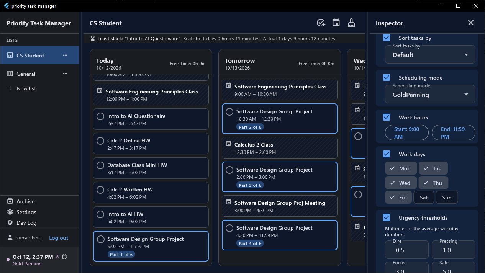

# Priority Task Manager

## Project Summary

**Make a plan that fits the day you actually have.**

Priority Task Manager turns tasks and commitments into a realistic work plan around estimated effort, deadlines, dependencies, work hours, and fixed events. It helps answer not only what is outstanding, but what can fit and what needs to wait.

**Platforms:** Web and Windows desktop · **License:** MIT

> Guest mode supports local task, list, and plain-event management. Schedule generation is online-only and requires an authenticated account with Subscription access.

[Quick Start](#quick-start) · [Current capabilities](#current-capabilities-at-a-glance) · [Current maturity](#current-maturity-snapshot)



## Why This Project Exists

Task managers are good at collecting work, but people still have to repeatedly decide what fits before deadlines. Priority Task Manager aims to reduce that re-triage by building a plan from the work to be done and the time actually available—and by keeping work that cannot be scheduled visible.

## Current Capabilities at a Glance

- **Plan around real constraints.** For users with schedule access, schedules account for estimates, due dates, task dependencies, configured work hours, and fixed events.
- **See how work fits.** Eligible tasks can be split into scheduled parts across available time; work that cannot be placed remains visible as unscheduled.
- **Manage work on web or desktop.** The Flutter client supports task, list, and event management on web and Windows. Guest data is stored locally; signed-in account data uses the API.

## Quick Start

### Prerequisites

- .NET SDK 10.0 or later
- Flutter SDK matching the version pinned in `PriorityTaskManager.Flutter/pubspec.yaml` (`environment.sdk`)

Build the .NET solution:

```bash
dotnet build
```

Run the Flutter client:

```bash
cd PriorityTaskManager.Flutter
flutter pub get
flutter run -d windows   # or -d chrome for web
```

Guest mode can be used without a running API. The client defaults to a local API at `http://127.0.0.1:5299`; account-backed features require a running API and reachable PostgreSQL database, and schedule generation additionally requires Subscription access. See [docs/WORKFLOW.md](docs/WORKFLOW.md) for running the API and database locally.

To point the client at the hosted API instead:

```bash
flutter run -d windows --dart-define=API_BASE_URL=https://tpm-api.fly.dev
```

See [docs/ARCHITECTURE_INTEGRATIONS.md](docs/ARCHITECTURE_INTEGRATIONS.md) for API and hosting details.

## Repository Map

| Path | Purpose |
| --- | --- |
| `PriorityTaskManager/` | Core models, services, persistence, and scheduling logic |
| `PriorityTaskManager.API/` | ASP.NET Core API for authenticated account operations and schedule computation |
| `PriorityTaskManager.Flutter/` | Flutter web and desktop client |
| `PriorityTaskManager.Tests/` | Active unit and API test project |
| `PriorityTaskManager.CLI/` | Archived CLI source; unsupported and excluded from the active solution and test suite |
| `pt_prototyping/` | Standalone Flutter sandbox for UI/UX prototyping, not part of the shipped product |
| `docs/` | Product, architecture, status, workflow, and testing documentation |

## Documentation Map

- [docs/VISION.md](docs/VISION.md): long-term direction, target users, and product differentiator.
- [docs/PRODUCT_BEHAVIOR_SPECIFICATION.md](docs/PRODUCT_BEHAVIOR_SPECIFICATION.md): draft of intended user-facing behavior and open product decisions.
- [docs/STATUS.md](docs/STATUS.md): current capabilities, limitations, known issues, and validation notes.
- [docs/ARCHITECTURE.md](docs/ARCHITECTURE.md): architecture map and focused reading paths.
- [docs/ARCHITECTURE_INTEGRATIONS.md](docs/ARCHITECTURE_INTEGRATIONS.md): API surface and integration boundaries.
- [docs/WORKFLOW.md](docs/WORKFLOW.md): development workflow, local setup, and deployment guidance.
- [docs/TESTING_STRATEGY.md](docs/TESTING_STRATEGY.md): testing philosophy and quality expectations.
- Repository GitHub Issues: backlog and planned work.

## Current Maturity Snapshot

- Gold Panning is the active scheduling strategy; constraint optimization is not yet available as a usable mode.
- Guest mode provides local task, list, and plain-event management. Guests do not receive computed schedules, and Guest recurring tasks are not supported.
- Authenticated users can use account-backed data and recurring tasks. Schedule computation is served by the authenticated, Subscription-gated API.
- Guest-to-account data migration is not currently available.

For the full feature matrix, known limitations, and current validation results, see [docs/STATUS.md](docs/STATUS.md).

## For Contributors

Start with [docs/WORKFLOW.md](docs/WORKFLOW.md) when changing code. Use [docs/ARCHITECTURE.md](docs/ARCHITECTURE.md) to understand system boundaries, and check [docs/STATUS.md](docs/STATUS.md) before assuming a feature is implemented.

## License

This project is licensed under the MIT License.
